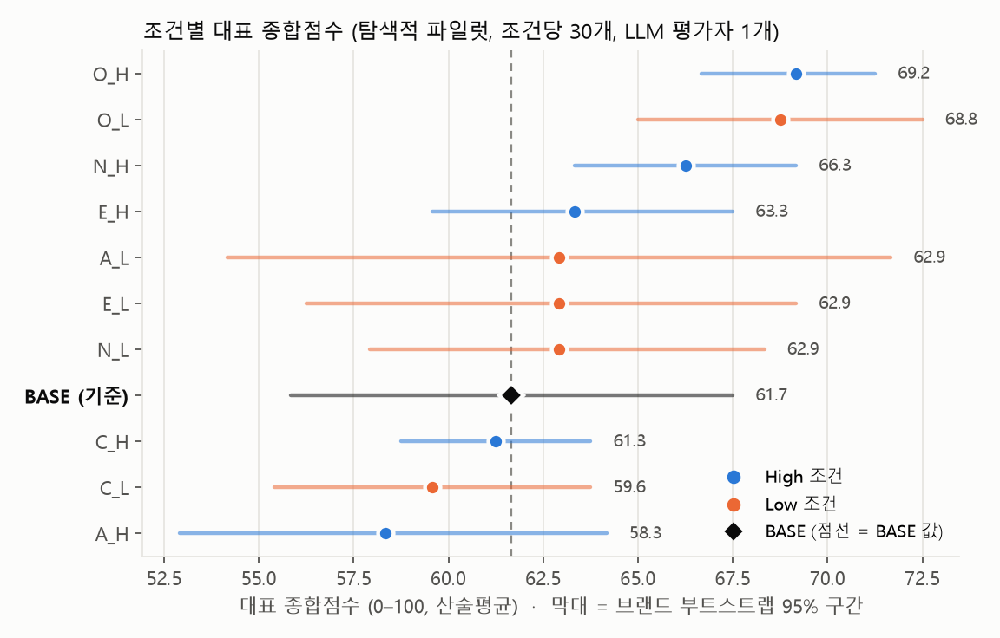
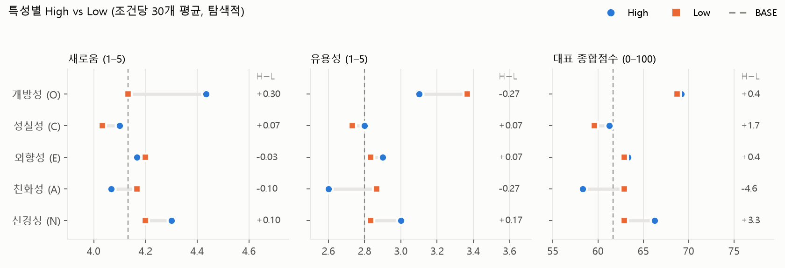
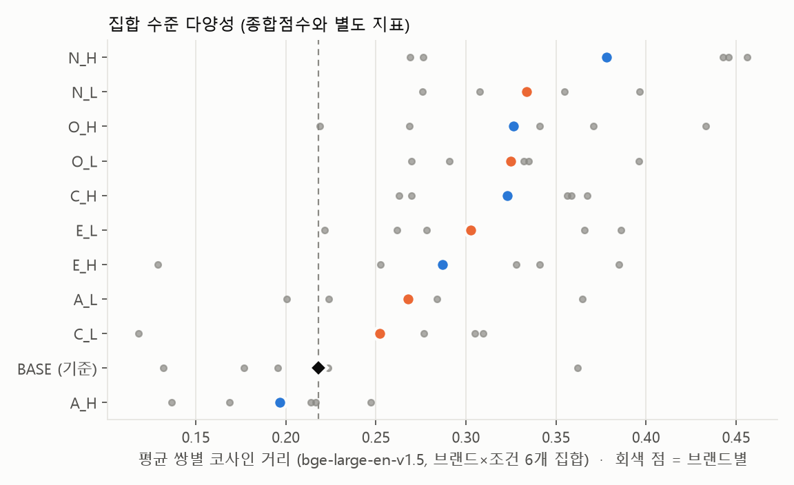
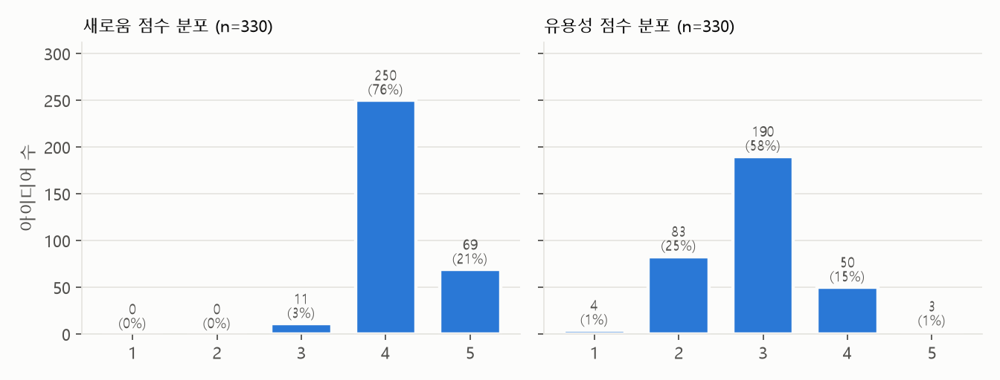
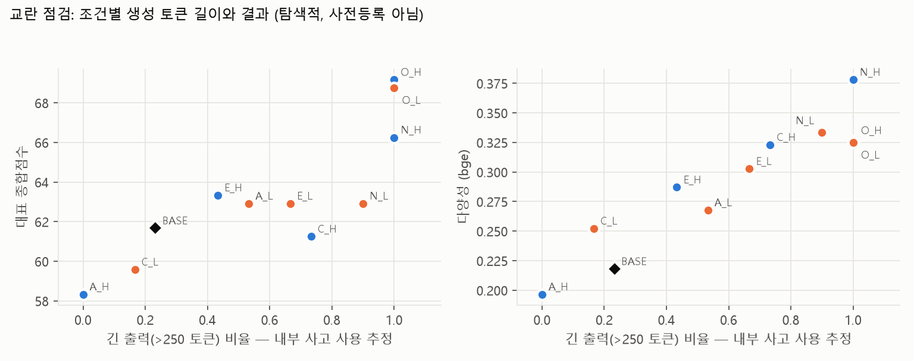

# 파일럿 v1 결과 보고서 (v1.1, 표시·집계 개선판)

> **탐색적 파일럿 결과다. 확인된 성격별 성능 순위가 아니다.** 브랜드 5개(IKEA, Klarna, Roblox, Slack, Unesco), 조건별 아이디어 30개(브랜드당 6개), 생성 모델 claude-sonnet-5-5, 평가자는 LLM 1개(claude-opus-4-7)다. 사람 평가와의 일치 여부는 아직 검증되지 않았다.

> 이 보고서는 저장된 생성·평가·조작 확인 기록에서 다시 계산했다. 새로 생성하거나 평가하지 않았다. 이전 보고서 `report.md`와 `summary.json`은 수정하지 않았다.

## 1. 대표 종합점수의 정의와 집계

- 아이디어별로 `종합 = 100 × (0.5 × (새로움−1)/4 + 0.5 × (유용성−1)/4)`를 구한다. 새로움과 유용성은 각각 1–5점이고, 두 축의 비중은 같다.
- 점수가 정수라 종합점수가 가질 수 있는 값은 5가지뿐이다(12.5점 간격; 관찰된 값: 37.5, 50, 62.5, 75, 87.5).
- **집계 규칙:** 조건 점수는 브랜드별 평균을 먼저 구한 뒤, 그 브랜드 평균들을 같은 비중으로 평균한다. 브랜드마다 사례 수가 달라도 특정 브랜드의 비중이 커지지 않게 하기 위해서다. 이번 자료는 모든 브랜드×조건 셀이 [6]개로 같아서, 아이디어 전체를 그냥 평균한 값과 정확히 일치한다(최대 차이 7.1e-15).
- **BASE 대비 차이:** 각 브랜드 안에서 (조건 평균 − BASE 평균)을 구하고 브랜드에 걸쳐 평균한다. 95% 구간은 브랜드 단위 부트스트랩(10,000회, 시드 고정)이다. 괄호 (↑/↓)는 BASE보다 높았던/낮았던 브랜드 수다(5개 중; 나머지는 동률).
- 순위와 차이는 원자료로 계산하고, 표에 보일 때만 반올림한다. 원자료 값이 정확히 같으면 같은 순위를 준다.

## 2. 조건 비교표 (대표 종합점수 순)

| 순위 | 조건 | 새로움 평균 | 유용성 평균 | **대표 종합점수** [95% 구간] | BASE 대비 차이 [95% 구간] (↑/↓) | n |
|---|---|---|---|---|---|---|
| 1 | O_H | 4.43 | 3.10 | **69.2** [66.7, 71.3] | +7.5 [+2.5, +12.5] (4/0) | 30 |
| 2 | O_L | 4.13 | 3.37 | **68.8** [65.0, 72.5] | +7.1 [-0.4, +13.8] (4/1) | 30 |
| 3 | N_H | 4.30 | 3.00 | **66.3** [63.3, 69.2] | +4.6 [-2.1, +12.1] (3/1) | 30 |
| 4 | E_H | 4.17 | 2.90 | **63.3** [59.6, 67.5] | +1.7 [-1.3, +4.6] (3/2) | 30 |
| 5 | A_L | 4.17 | 2.87 | **62.9** [54.2, 71.7] | +1.3 [-6.7, +9.2] (2/2) | 30 |
| 5 | E_L | 4.20 | 2.83 | **62.9** [56.3, 69.2] | +1.3 [-1.3, +3.8] (3/2) | 30 |
| 5 | N_L | 4.20 | 2.83 | **62.9** [57.9, 68.3] | +1.3 [-4.6, +6.7] (3/2) | 30 |
| 8 | **▶ BASE (성격 미지정)** | 4.13 | 2.80 | **61.7** [55.8, 67.5] | 기준 | 30 |
| 9 | C_H | 4.10 | 2.80 | **61.3** [58.8, 63.8] | -0.4 [-5.8, +6.3] (2/3) | 30 |
| 10 | C_L | 4.03 | 2.73 | **59.6** [55.4, 63.8] | -2.1 [-7.9, +3.8] (2/3) | 30 |
| 11 | A_H | 4.07 | 2.60 | **58.3** [52.9, 64.2] | -3.3 [-7.5, +0.0] (0/2) | 30 |

동률(원자료 기준 같은 값, 부동소수점 오차 1e-9 이내): A_L = E_L; E_L = N_L. 공동 순위를 주었고, 표의 위아래 순서는 조건 이름순이다.

- 브랜드 5개로 만든 부트스트랩 구간이라 거칠다. 같은 자료에서 여러 대비를 동시에 봤으므로 일부 구간이 0을 벗어나는 것은 우연으로도 기대된다.

## 3. 특성별 High vs Low

| 특성 | 지표 | High | Low | High − Low [95% 구간] (H>L / L>H 브랜드 수) |
|---|---|---|---|---|
| 개방성 (O) | 새로움 | 4.43 | 4.13 | +0.30 [+0.13, +0.43] (4/0) |
| 개방성 (O) | 유용성 | 3.10 | 3.37 | -0.27 [-0.50, -0.03] (0/3) |
| 개방성 (O) | 종합 | 69.2 | 68.8 | +0.4 [-2.9, +4.2] (2/3) |
| 성실성 (C) | 새로움 | 4.10 | 4.03 | +0.07 [-0.07, +0.17] (3/1) |
| 성실성 (C) | 유용성 | 2.80 | 2.73 | +0.07 [-0.07, +0.20] (2/1) |
| 성실성 (C) | 종합 | 61.3 | 59.6 | +1.7 [-0.8, +4.2] (2/1) |
| 외향성 (E) | 새로움 | 4.17 | 4.20 | -0.03 [-0.27, +0.13] (2/1) |
| 외향성 (E) | 유용성 | 2.90 | 2.83 | +0.07 [-0.17, +0.30] (2/1) |
| 외향성 (E) | 종합 | 63.3 | 62.9 | +0.4 [-2.9, +4.6] (1/2) |
| 친화성 (A) | 새로움 | 4.07 | 4.17 | -0.10 [-0.40, +0.20] (2/2) |
| 친화성 (A) | 유용성 | 2.60 | 2.87 | -0.27 [-0.60, +0.10] (1/3) |
| 친화성 (A) | 종합 | 58.3 | 62.9 | -4.6 [-12.5, +2.5] (1/2) |
| 신경성 (N) | 새로움 | 4.30 | 4.20 | +0.10 [-0.13, +0.33] (2/2) |
| 신경성 (N) | 유용성 | 3.00 | 2.83 | +0.17 [+0.00, +0.43] (2/0) |
| 신경성 (N) | 종합 | 66.3 | 62.9 | +3.3 [-0.8, +7.5] (3/2) |

- 개방성에서는 High가 새로움에서 앞서고 Low가 유용성에서 앞서서, 종합점수 차이는 거의 0이다. 종합점수만 보면 이런 맞교환이 가려지므로 두 축을 함께 봐야 한다.

## 4. 다양성 (집합 수준, 종합점수와 별도)

다양성은 아이디어 하나가 아니라 같은 브랜드×조건의 아이디어 6개 집합에 대한 값이다. 따라서 종합점수에 합치지 않는다. 지표는 원 논문과 같은 BAAI/bge-large-en-v1.5 임베딩의 평균 쌍별 코사인 거리이고, TF-IDF 거리는 어휘 수준 보조 지표다.

| 조건 | 다양성 (bge) | BASE 대비 [95% 구간] (↑/↓) | TF-IDF 다양성 |
|---|---|---|---|
| N_H | 0.378 | +0.160 [+0.096, +0.224] (5/0) | 0.924 |
| N_L | 0.334 | +0.116 [+0.024, +0.187] (4/1) | 0.909 |
| O_H | 0.326 | +0.109 [+0.028, +0.189] (4/1) | 0.903 |
| O_L | 0.325 | +0.107 [+0.070, +0.140] (5/0) | 0.895 |
| C_H | 0.323 | +0.105 [+0.043, +0.156] (4/1) | 0.898 |
| E_L | 0.303 | +0.085 [+0.036, +0.133] (5/0) | 0.890 |
| E_H | 0.287 | +0.069 [+0.014, +0.124] (4/1) | 0.885 |
| A_L | 0.268 | +0.050 [-0.002, +0.109] (4/1) | 0.862 |
| C_L | 0.252 | +0.034 [-0.018, +0.088] (3/2) | 0.855 |
| **▶ BASE** | 0.218 | 기준 | 0.829 |
| A_H | 0.197 | -0.021 [-0.089, +0.037] (3/2) | 0.818 |

- BASE는 같은 아이디어를 반복하는 경향이 있었다(예: IKEA 6개 모두 이별 쇼룸 계열). 서로 반대 방향인 O_H와 O_L이 비슷하게 높아서, 다양성 상승은 특정 특성 방향보다는 '성격 문장 추가' 또는 추론 길이 차이(7절)와 더 잘 맞는다.

## 5. 보조 지표: 조화평균 종합점수와 바닥 비율

- 조화평균 = `100 × 2NU/(N+U)`(N, U는 0–1 정규화 점수, N+U=0이면 0). **새로움이나 유용성 중 하나라도 1점이면 정규화 값이 0이 되어, 다른 항목이 5점이어도 조화평균은 0점이다.** 두 항목이 모두 좋아야 높게 나오는 엄격한 지표라 보조로만 쓴다.
- 이번 자료에서 1점은 새로움 0건, 유용성 4건이다(어느 축이든 1점인 아이디어는 전체의 1.2%). 바닥 비율이 낮으면 '0점 처리'가 조건 비교를 크게 바꾸지 않는다. 다만 조화평균은 두 축 중 낮은 쪽의 차이를 더 크게 반영한다.

| 조건 | 대표 종합(산술) | 조화평균(보조) | BASE 대비(조화) | 바닥 비율 (어느 축이든 1점) |
|---|---|---|---|---|
| O_H | 69.2 | 63.6 | +9.4 | 0.000 |
| O_L | 68.8 | 66.3 | +12.0 | 0.000 |
| N_H | 66.3 | 59.8 | +5.5 | 0.000 |
| E_H | 63.3 | 57.5 | +3.2 | 0.000 |
| A_L | 62.9 | 57.3 | +3.1 | 0.000 |
| E_L | 62.9 | 55.3 | +1.1 | 0.033 |
| N_L | 62.9 | 56.5 | +2.2 | 0.000 |
| **▶ BASE** | 61.7 | 54.3 | 기준 | 0.033 |
| C_H | 61.3 | 55.5 | +1.3 | 0.000 |
| C_L | 59.6 | 53.4 | -0.9 | 0.000 |
| A_H | 58.3 | 49.2 | -5.1 | 0.067 |

## 6. 새로움·유용성 점수 분포

| 점수 | 1 | 2 | 3 | 4 | 5 |
|---|---|---|---|---|---|
| 새로움 | 0 (0.0%) | 0 (0.0%) | 11 (3.3%) | 250 (75.8%) | 69 (20.9%) |
| 유용성 | 4 (1.2%) | 83 (25.2%) | 190 (57.6%) | 50 (15.2%) | 3 (0.9%) |

- **쏠림 확인:** 새로움은 4–5점에 96.7%, 유용성은 2–3점에 82.7%가 몰려 있다. 특히 새로움은 천장(4–5점)에 몰려 조건 간 구분력이 낮다. Wild Ideas 과제가 원래 '기이한 아이디어'를 요구하므로, 현재 채점표로는 모든 응답이 '새롭다'로 판정되기 쉽다.
- 조건별 분포(새로움 1–5 / 유용성 1–5 건수):

| 조건 | 새로움 1/2/3/4/5 | 유용성 1/2/3/4/5 |
|---|---|---|
| BASE | 0/0/2/22/6 | 1/9/15/5/0 |
| O_H | 0/0/0/17/13 | 0/3/21/6/0 |
| O_L | 0/0/1/24/5 | 0/0/20/9/1 |
| C_H | 0/0/0/27/3 | 0/8/20/2/0 |
| C_L | 0/0/1/27/2 | 0/11/16/3/0 |
| E_H | 0/0/1/23/6 | 0/7/19/4/0 |
| E_L | 0/0/2/20/8 | 1/10/12/7/0 |
| A_H | 0/0/2/24/4 | 2/11/14/3/0 |
| A_L | 0/0/1/23/6 | 0/9/16/5/0 |
| N_H | 0/0/0/21/9 | 0/6/20/2/2 |
| N_L | 0/0/1/22/7 | 0/9/17/4/0 |

## 7. 교란 점검: 조건별 생성 토큰

| 조건 | 출력 토큰 중앙값 | 긴 출력(>250 토큰) 비율 |
|---|---|---|
| BASE | 108 | 0.23 |
| O_H | 698 | 1.00 |
| O_L | 631 | 1.00 |
| C_H | 559 | 0.73 |
| C_L | 98 | 0.17 |
| E_H | 111 | 0.43 |
| E_L | 493 | 0.67 |
| A_H | 102 | 0.00 |
| A_L | 408 | 0.53 |
| N_H | 670 | 1.00 |
| N_L | 622 | 0.90 |

- 이 분석은 사전등록하지 않은 탐색 분석이다. 출력 토큰은 약 100개와 400–1,100개 두 무리로 나뉜다(내부 사고 사용 여부로 추정). 그 비율이 성격 문장에 따라 0%에서 100%까지 달라졌고, 긴 출력 비율이 높은 조건이 다양성과 유용성도 높은 경향이 있다.

## 8. 성격 조작 확인 (IPIP-50 자기보고, 조건당 3회)

| 조건 | O | C | E | A | N | 표적 변화 vs BASE | 표적 외 평균 절대 변화 |
|---|---|---|---|---|---|---|---|
| BASE | 4.40 | 4.33 | 3.23 | 4.63 | 1.27 | — | — |
| O_H | 4.83 | 4.37 | 3.53 | 4.67 | 1.17 | +0.43 | 0.12 |
| O_L | 2.17 | 4.77 | 2.93 | 4.57 | 1.07 | -2.23 | 0.25 |
| C_H | 4.57 | 4.97 | 3.50 | 4.60 | 1.10 | +0.63 | 0.16 |
| C_L | 4.60 | 2.00 | 3.23 | 4.43 | 1.07 | -2.33 | 0.15 |
| E_H | 4.73 | 4.60 | 4.87 | 4.83 | 1.23 | +1.63 | 0.21 |
| E_L | 4.60 | 4.73 | 1.87 | 4.47 | 1.10 | -1.37 | 0.23 |
| A_H | 4.40 | 4.50 | 3.67 | 4.90 | 1.10 | +0.27 | 0.19 |
| A_L | 4.83 | 4.57 | 3.50 | 2.17 | 1.50 | -2.47 | 0.29 |
| N_H | 4.67 | 4.33 | 3.33 | 4.77 | 4.40 | +3.13 | 0.13 |
| N_L | 4.60 | 4.57 | 3.53 | 4.80 | 1.10 | -0.17 | 0.23 |

- Low 지시와 N_H는 표적 특성을 크게 움직였다. High 지시(O, C, A)와 N_L은 BASE가 이미 천장이나 바닥 근처라 변화가 작았다.

## 9. 해석과 한계

1. **탐색적 파일럿이다.** 브랜드 5개, 조건별 30개 아이디어(브랜드당 6개), 평가자는 LLM 1개다. 순위는 이 모델·프롬프트·평가자에서 관찰된 값일 뿐, 확인된 성격별 성능 순위가 아니다. 10개 성격 조건 × 여러 지표를 비교했으므로 p값을 보고하지 않는다.
2. **사람 평가와의 일치가 검증되지 않았다.** 원 논문은 LLM 평가자와 인간 순위의 일치가 약하다고 보고했다. 원 논문의 인간 쌍대 선호 레이블은 공개되지 않아 쓰지 못했다(써도 새 결과물의 정답 점수가 되지 않는다). 조건을 가린 사람 평가 자료가 `human_eval/`에 있다.
3. **생성 토큰 차이 때문에 성격 지시의 효과와 추론 과정의 효과를 구분하기 어렵다.** 7절 참조. 이번 CLI 환경에서는 사고 사용과 온도를 통제할 수 없었다.
4. **성격 조작 확인은 자기보고 설문이다.** 아이디어 문장 자체에 성격이 드러났는지는 따로 측정하지 않았다.
5. 새로움 점수가 천장에 몰려 있어(6절) 조건 간 새로움 차이는 과소 추정되었을 수 있다.
6. 대표 종합점수 공식(산술 50:50)은 사전등록에서 '파일럿의 주 종합점수'로 정했던 것과 같다. 본 실험의 최종 공식으로는 사용자가 파일럿 결과를 본 뒤 2026-11-12에 확정했다. 따라서 이번 파일럿에 대해서는 사후 선택이 아니며, 본 실험(v2)에는 사전 확정 공식으로 적용된다.

## 10. 계산 검증 (이전 결과와 대조)

`verification_v1.1.json` 요약:

- 아이디어별 종합점수: 이전 `idea_level_scores.csv`의 comp_mean과 최대 차이 0.0e+00. 원점수 불일치 0건.
- 조건 평균: 이전 summary.json과 최대 차이 {"n": 8.9e-16, "u": 4.4e-16, "comp": 7.1e-15, "harm": 7.1e-15, "floor": 0.0}.
- BASE 대비 차이: 최대 차이 {"n": 0.0, "u": 0.0, "comp": 0.0, "harm": 5.3e-15}. 95% 구간 끝점 최대 차이 {"n": 0.0, "u": 0.0, "comp": 0.0, "harm": 8.9e-15}.
- 다양성(bge) 조건 평균: 최대 차이 0.0e+00.
- 반올림 때문에 같아 보이지만 원자료로는 다른 순위: 없음. 원자료 완전 동률: [['A_L', 'E_L'], ['E_L', 'N_L']].
- 표의 'BASE 대비 차이'(원자료 차이를 반올림)와 '반올림된 평균끼리의 차이'가 다르게 보이는 조건: ['E_H', 'E_L', 'A_H', 'A_L', 'N_L']. 계산 오류가 아니라 표시 방식 때문이다. 예를 들어 E_H는 표에 63.3, BASE는 61.7로 보여 둘을 빼면 +1.6이지만, 원자료 차이는 63.333 − 61.667 = +1.667이라서 +1.7로 표시된다. 차이와 순위는 항상 원자료로 계산한다.
- 표시 반올림: 부동소수점 오차를 없애려고 소수 9자리에서 정리한 뒤 사사오입한다. 이전 보고서(`report.md`)는 파이썬 기본 반올림을 써서, 정확히 +1.25인 차이가 조건에 따라 +1.3(A_L)과 +1.2(E_L, N_L)로 다르게 표시됐다. 원자료 값은 셋 다 +1.25로 같다.
- 위 규칙 때문에 이전 보고서와 표시값이 0.1 달라진 항목(값 자체는 동일): BASE 조화: 이전 54.2 → 현재 54.3 (원값 54.2500); C_H 종합: 이전 61.2 → 현재 61.3 (원값 61.2500); N_H 종합: 이전 66.2 → 현재 66.3 (원값 66.2500).
